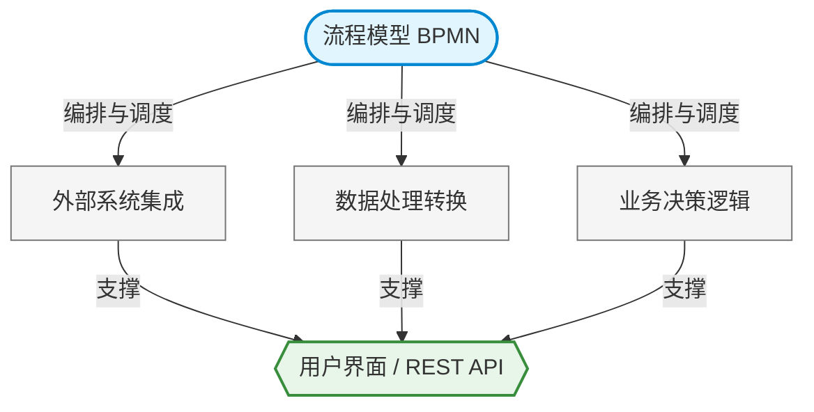

在接触 BPM（业务流程管理）或 ORION 流程引擎时，无论是初学者还是部分业务架构师，都极易陷入一个认知误区：**将“流程应用”（Process Application）等同于一张 BPMN 流程图。**

在真实的企业级生产环境中，流程模型（BPMN）仅仅是整个应用的一小部分。一个真正能够跨部门、跨系统稳定运行的流程应用，不仅需要精妙的流程设计，更需要海量的底层设施来支撑集成、计算、数据转换与容错处理。

本文将剥开流程图的表象，为您解构一个完整的企业级流程应用到底包含哪些不可或缺的技术组件。

## 流程模型：应用的“骨架”而非“肌肉”

BPMN 流程模型的核心职责是**描述业务流程的流转路径**。例如：
*   一个客户订单如何依次经过层层审批。
*   一个采购流程在遇到超预算时如何回退。
*   多个子任务如何并行处理，并在全部完成后合并。

它通过标准的符号（Task 活动、Gateway 网关、Event 事件、Sub-process 子流程、Pool/Lane 参与者池）定义了规则。流程引擎负责忠实地执行这个模型，并记录沿途发生的所有状态变迁。

**但骨架无法独立行走。**
例如模型中有一个节点叫“审批通过后通知 ERP 系统发货”。流程图只能在语义上标明“这里需要发货”，但真正发起网络请求、处理鉴权、构建报文并调用 ERP 系统的动作，BPMN 本身是无法凭空完成的。流程模型只是整个应用的**业务编排层**，我们需要为其注入真正的技术实现。

---

## 完整流程应用的五大核心拼图

在真实的工程落地中，一个完整的流程应用架构可以抽象为以下层级关系：



一个可以直接上生产环境的完整流程应用，其技术架构通常包含以下五个核心维度：

### 1. Connectivity（系统连接性）
现代企业系统无一例外是分布式的。一个典型的端到端流程，往往需要穿透多个异构系统：
*   调用外部 REST API 或 SOAP Web Service
*   向 Kafka 或 RabbitMQ / AMQP 投递异步消息
*   直接操作关系型数据库或读取 LDAP 目录
*   调用第三方 SaaS 服务（如电子签章、邮件服务器）

**执行场景：**
`订单审批完成 -> 调用 ERP REST API 创建销售单 -> 向 AMQP 发送备货指令 -> 仓库系统开始响应`
在这个链路中，流程引擎控制的是“执行顺序”，而真正触达外部系统的，是流程应用中的连接器（Connector）或外部服务代码。即便像 ORION 引擎提供了开箱即用的 HTTP-Connector，对于高复杂度的系统集成，依然需要专业的微服务来承担桥梁作用。

### 2. Data Processing & Transformation（数据处理与转换）
现实世界中，上下游系统的数据格式几乎永远是对不上的。

例如，上游 CRM 系统抛出的客户数据是：
```json
{
  "customerName": "Tom",
  "mobile": "13800000000"
}

```

而下游的 ERP 系统 API 要求的入参格式却是：

```json
{
  "name": "Tom",
  "phone": "13800000000",
  "source": "CRM"
}

```

流程应用必须承担起数据转换的重任，包括字段映射、JSON/XML 互转、数据清洗、单位换算、日期格式化以及数据的拆分与聚合。
这些脏活累活通常不会在业务侧的 BPMN 流程图上体现（为了保持模型整洁），而是在底层的服务任务（Service Task）或脚本处理中默默完成。没有强大的数据转换层，系统的上下游就会彻底断档。

### 3. Business Decision（流程路由决策）

BPMN 流程图中最关键的能力之一，就是通过网关（Gateway）决定流程的分支走向。
例如：`报销金额 > 100,000`？如果是，走向“总经理审批”；如果否，走向“财务审批”。

流程模型定义了“**这里有几条路可走**”，而真正决定“**到底走哪条路**”的，是背后的业务决策逻辑。这些决策参数可能极其复杂，涉及：金额、地区、风险等级、用户角色、甚至是外部的信用评分。

为此，流程应用需要对接多种决策引擎：

* Java 原生条件判断
* DMN（决策模型和标记语言）或 Decision Table
* Drools 等专业规则引擎
* 甚至是外部的 AI 智能风控服务

### 4. Business Logic（领域业务逻辑）

正如我们在上一篇架构原则中所强调的，核心的业务计算逻辑绝不应硬编码在流程模型中。
诸如“计算复杂的阶梯折扣”、“强一致性的库存扣减”、“生成具有特定规则的订单流水号”等操作，都属于纯粹的领域业务逻辑。

在 ORION 的技术体系中，我们极力推荐通过外部任务（External Task）模式，将这些业务逻辑与流程模型彻底解耦。流程引擎只负责发布任务并挂起等待，由外部的微服务 Worker 拉取任务、执行计算并返回结果。这种结合点让流程保持了高度的清晰，也让业务代码能够独立测试与扩缩容。

### 5. Error Handling（韧性与异常处理）

理想的流程图总是畅通无阻，但真实的生产环境充满了灾难：网络瞬断、REST 调用超时、MQ 宕机、并发锁冲突、外部数据校验失败。

一个及格的流程应用必须具备强大的容错与韧性机制：

* **Retry**：技术异常时的自动化重试策略。
* **Timeout & Error Event**：超时触发的边界事件与业务异常抛出。
* **Compensation**：分布式事务失败时的业务反向补偿动作。
* **Incident Management**：阻断性故障发生时的运维告警与人工干预平台。
* **Dead Letter Queue (DLQ)**：死信队列处理。

---

## 延展思考：Agentic AI 时代的流程应用

在大语言模型（LLM）与 Agent 技术崛起的今天，流程应用的内涵正在被进一步拓宽。

在上述的五大拼图中，AI 正在重塑其中的某些关键环节：

* 在数据处理（Data Processing）环节：Agent 可以代替死板的脚本，从非结构化的合同邮件中精准提取出下游 ERP 所需的 JSON 字段。
* 在业务决策（Business Decision）环节：不再仅仅依赖 `if-else` 或固定的 DMN 规则表，AI 可以基于意图分析，为网关提供更加柔性和智能的路由建议。

然而，无论 AI 的局部能力多么强大，它依然扮演的是“高级连接器”或“智能运算节点”的角色。它必须被无缝嵌入到由 BPMN 构筑的“骨架”之中。流程模型依然是那个确保企业契约、规则底线和全局状态一致性的核心枢纽。

## 总结

流程应用（Process Application）从来不是一张单薄的 BPMN 流程图，而是一个涵盖了编排模型、系统集成、数据清洗、决策路由与高可用容错的**完整业务系统**。

只有将清晰的流程模型与强大的底层集成逻辑有机结合，才能构建出稳定、灵活且易于演进的企业级架构。这也是 ORION 专注于“业务编排”的价值所在：不仅要让流程图画得好看，更要作为企业各类异构系统、人力资源与 AI Agent 之间的协同中枢，让业务在错综复杂的现实环境中真正运转起来。
