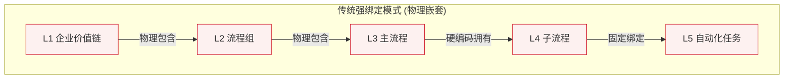
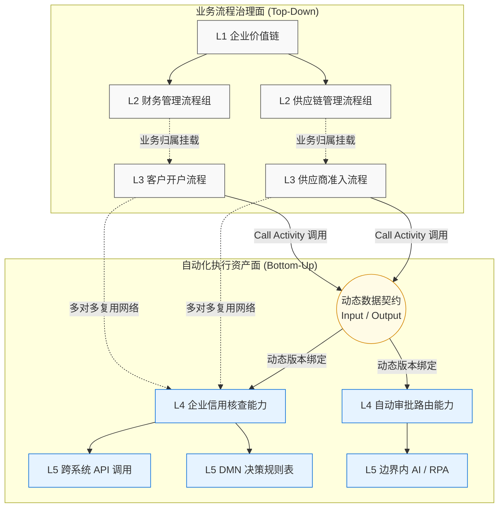
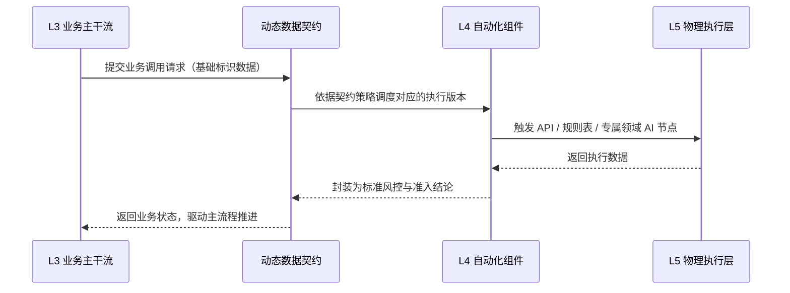

import { Aside, Card, CardGrid } from '@astrojs/starlight/components';

# 业务流程治理与自动化执行解耦架构

在企业数字化转型过程中，业务流程自动化平台通常面临一个客观存在的架构矛盾：企业既需要稳固的流程架构治理体系，又需要能敏捷响应业务变化的自动化执行能力。

传统流程管理平台往往采用严格的物理树状流程模型：

```text
L1 企业价值链
    |
    L2 流程组
        |
        L3 主流程
            |
            L4 子流程
                |
                L5 自动化任务

```

此模型在流程建设初期逻辑清晰，但随着企业自动化场景的扩展，各层级间生命周期的内在冲突便会逐渐暴露：

* L1/L2 作为企业级架构治理资产，以维持稳定性为主，变更缓慢；
* L3 作为端到端业务主流程资产，需根据业务策略进行常规优化；
* L4/L5 作为底层自动化执行资产，要求较高的敏捷性与高频迭代。

若所有层级均采用强物理绑定：

* 底层自动化逻辑的优化将被迫触发上层架构的变更审批，增加沟通成本；
* 单一的自动化能力无法被跨域的多个业务流程直接共享；
* 流程资产池容易产生冗余代码和维护孤岛。

ORION 的架构设计目标是：**在保持企业级业务流程治理结构稳定的同时，使底层自动化执行资产具备独立演进与多维复用的能力。**

基于此，ORION 将宏观流程体系在逻辑上拆分为两大平面：

1. **业务流程治理体系（Process Governance）**
2. **自动化执行资产体系（Automation Execution Asset）**

两者不再物理嵌套，而是通过动态契约（Dynamic Contract）建立松耦合的映射连接。

---

## 1. 企业流程架构中的 L1-L5 重新定义

在 ORION 的高阶业务编排架构中，并非将 L1-L5 完全割裂。其逻辑关系定义如下：

* **L1-L3 维系企业业务架构上的逻辑分类与关联。**
* **L4-L5 作为可独立运行的自动化组件被统一纳管。**
* **L3 通过数据契约机制，调用 L4/L5 的执行能力。**

| 层级 | 定位 | 核心作用 | 建模形式 | 变更频率 |
| --- | --- | --- | --- | --- |
| **L1 价值链** | 企业业务全景 | 描述企业核心能力地图与全景视图 | 价值链图 (Value Chain) | 极低 |
| **L2 流程组** | 业务能力域 | 对流程能力进行分类治理与权责划分 | 流程树 (Process Catalog) | 低 |
| **L3 主流程** | 端到端业务流 | 描述业务目标达成与跨部门协作路由 | 高阶 BPMN (High Level) | 中 |
| **L4 子流程** | 自动化能力单元 | 封装高内聚、可复用的业务自动化能力 | 可执行 BPMN (Executable) | 高 |
| **L5 任务级** | 技术执行单元 | 具体的 API、DMN 规则、RPA 脚本及特定领域片段内的 AI 决策节点调用 | 任务级 BPMN / DMN | 极高 |

---

## 2. 传统流程平台的局限：治理与执行强绑定

传统流程平台通常采用基于文件夹的物理树形继承模型：



### 2.1 自动化资产复用受限

以“企业信用核查”这一通用能力为例。在实际业务中，该能力可能同时服务于多个主干流程：

* 供应商准入审批
* 对公客户开户
* 大客户授信评估
* 重大合同审核

但在强绑定模型中，构建路径通常如下：

```text
供应商准入流程 (L3)
      |
      企业信用核查 (L4)

```

此时“信用核查”在系统结构上属于“供应商准入”的分支。为了在其他业务线使用相同功能，系统内往往会产生多份复制版本：

* 供应商信用核查 v1
* 客户信用核查 v1
* 授信信用核查 v1

这种结构增加了研发资源的消耗与版本维护的难度。

---

## 3. ORION 双层架构：治理面与执行面的解耦

ORION 采用解耦的双轨运行机制来处理上述问题：

```text
业务流程治理面 (Governance Plane)
                  +
自动化执行资产面 (Execution Plane)

```

### 3.1 治理面（Governance Plane）

以结构化管理为核心，负责：

* 企业流程全局架构定义
* 流程资产的分类与索引
* 业务部门的权责边界划分
* 流程运营数据统计分析
* 流程血缘追踪

**主要纳管对象：** L1、L2、L3。

### 3.2 执行面（Execution Plane）

以逻辑落地与调度为核心，负责：

* 遵循 BPMN 2.0 规范的可执行逻辑编排
* 跨域系统集成与服务调用
* DMN 规则引擎与任务分发
* 边界限定内的特定领域 AI 任务处理

**主要纳管对象：** L4、L5。

### 3.3 架构模型映射



---

## 4. 动态契约机制：业务与自动化的连接层

在 ORION 中，L3 主流程与 L4 自动化组件并非通过硬编码嵌套，而是通过动态契约（Dynamic Contract）建立标准化的交互边界。

动态契约定义了调用时的业务标准：

* **输入业务边界：** 明确主流程需传递的基础业务标识与数据项。
* **输出业务结果：** 规范组件处理完成后返回的业务结论与状态指标。
* **异常处理机制：** 约定组件执行未达预期时的回退与路由策略。
* **版本控制规则：** 指定主流程所调用的执行组件版本及其升级机制。

L3 主流程的设计者只需了解契约所约定的业务输入与输出，无需关注底层逻辑的具体实现。

```text
业务主流程 (L3)
    |
    ↓
业务数据契约 (Contract)
    |
    ↓
自动化组件与执行层 (L4/L5)

```

这种机制使平台逻辑从“流程内部嵌套自动化”，转变为“流程节点调用公共自动化能力”。

### 4.1 基于 BPMN Call Activity 的规范调用

BPMN 2.0 标准中的 `Call Activity` 原生支持跨流程调度。在调度体系中：

* **L3 负责业务阶段路由与高阶编排；**
* **L4 负责具体自动化逻辑与业务动作的落地；**
* **Contract 负责连接时的业务数据校验与版本映射。**



### 4.2 业务逻辑与执行细节的分离

以“供应商准入流程”为例。从 L3 主流程的视角看，其调用的本质是获取确定的业务结论：

```text
输入需求：企业标识、基础申请信息
输出期望：综合风险评级、准入建议标识

```

而在“企业信用核查”能力内部（L4/L5），包含了具体的处理过程：

* 查询外部与内部数据源
* 执行风控拦截与规则评估
* 处理特定异常的工单分配

数据契约的存在，使主流程的设计保持简洁。技术团队可在不影响上层主流程的前提下，对底层执行逻辑进行独立优化与升级。

---

## 5. 自动化资产的组件化复用模型

随着自动化能力的积累，平台内具备持续生命力的资产是那些可被不同业务线调用的“企业级自动化组件”。

| 自动化能力组件 | 典型业务复用场景 |
| --- | --- |
| **企业信用核查** | 供应商准入、对公客户开户、授信评估 |
| **合同风险解析** | 合同签署、采购审查、销售合规校验 |
| **票据信息提取** | 差旅报销、对公付款、财务入账 |
| **工单智能分发** | 运维支持、客诉处理、需求路由 |

这些标准化模块共同构成了企业内部的能力组件库。

### 5.1 多维挂载网络

在传统模型中，子流程依附于单一主流程：

```text
一个主流程 ──包含──> 特定子流程

```

在 ORION 的多维挂载模型中：

```text
L3: 业务流程 A ↘
                ↘ (Call)
                  [通用 L4 自动化组件]
                ↗ (Call)
L3: 业务流程 B ↗

```

在此模式下，同一个自动化资产：

* 在引擎层面维持单一物理副本；
* 在运行期支持被不同业务域的主流程并发调用；
* 由专业部门（如风控或 IT 团队）进行统一的版本治理；
* 提供集中化的运行状态统计。

---

## 6. 流程血缘与变更影响分析

执行层面的解耦依赖于完善的元数据管理体系。系统在底层维持着动态的**流程血缘关系网 (Lineage Network)**。

### 6.1 业务血缘追踪 (Top-Down)

用于清晰展现宏观业务能力由哪些具体流程支撑：

```text
L1 战略价值链 ──穿透──> L2 核心流程组 ──穿透──> L3 端到端主干业务流

```

### 6.2 自动化血缘反查 (Bottom-Up)

用于明确底层自动化组件的调整将影响哪些上层业务：

```text
L5 底层执行动作 ──溯源──> L4 自动化组件 ──溯源──> Contract 契约约束 ──溯源──> 依赖该组件的多个 L3 业务流

```

### 6.3 变更影响分析 (Impact Analysis)

当团队计划更新某个 L4 组件时，系统基于血缘关系提供风险评估参考：

> **【变更目标】** 企业信用核查能力 L4 
> **【影响范围】** 该组件正被用于：供应商准入流程、客户开户流程、授信审批流程。

这为架构维护提供了客观依据，帮助评估变更范围，控制维护风险。

---

## 7. 异构版本治理与绑定策略

不同业务场景对底层组件版本更新的策略需求存在差异。系统支持在跨层调用时，针对单一契约配置不同的版本绑定策略：

| 绑定策略 | 运行时表现说明 | 适用场景 |
| --- | --- | --- |
| **固定锁定版 (Fixed)** | 关联指定历史版本，不随底层更新而自动变化 | 金融核算、合规审计等对稳定性要求严格的流程 |
| **动态最新版 (Latest)** | 始终调用该组件的最新稳定发布版本 | 内部协同、办公流转等允许跟随热更新的流程 |
| **灰度切换版 (Canary)** | 按设定比例逐步将流量切换至新版本 | 核心组件升级时的平滑过渡测试 |
| **环境隔离版 (Env)** | 依据运行环境自动匹配对应版本 | 多环境隔离开发与测试部署 |

**应用示例：**
针对相同的“信用核查”能力，合规要求较高的流程可绑定稳健的固定版本；而常规业务流程则可配置动态版本以使用最新的规则模型。通过策略配置，兼顾了系统的稳定性与功能的迭代需求。

---

## 8. 架构核心价值总结

企业在扩展流程自动化边界时，核心难点在于：自动化能力如何被规范化复制，并在维持全局治理秩序的前提下进行迭代。

传统紧耦合模式的局限：

```text
特定流程 = 强绑定自动化动作 ---> 业务流转变更往往要求底层动作连带修改

```

ORION 架构的解耦模式：

```text
高阶业务编排主干 + 模块化自动化能力池 + 标准动态调度契约 + 全局统一元数据治理

```

### 总结

ORION 的双轨架构设计理清了企业流程资产间的从属与调用逻辑：

> 上层业务流程负责编排企业的工作流转规则；下层自动化资产负责提供具体的执行能力。两者基于动态契约协同工作，在保证架构有序的同时，提高了自动化组件的交付效率与复用率。

这种架构设计使企业流程系统从传统的“流程流转工具”，升级为“企业业务编排与能力管理平台 (Enterprise Business Orchestration Platform)”。
