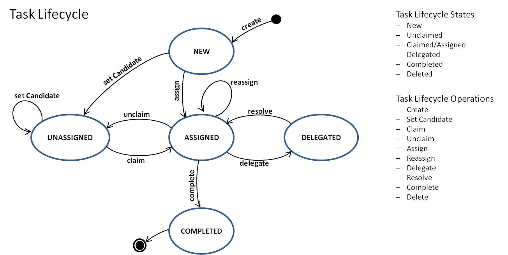

## 1. 描述 (Description)

用户任务（User Task）用于对必须由人工参与者完成的工作进行建模。

在 ORION 平台底层的执行态中，当执行流到达用户任务时，引擎会立即将当前的流程状态持久化到数据库中，并在目标用户或用户组的待办任务列表（Task List）中创建一条全新的任务记录。流程实例将在此处挂起，直到人工提交表单或完成任务后，状态机才会继续向下游推进。

## 2. 核心人员分配机制 (User Assignment)

底层引擎支持原生的 BPMN 资源分配，但在企业级架构中，推荐使用 ORION 扩展属性来实现直观的分配逻辑。

### 2.1 明确指派 (Assignee)
* **底层扩展**: `camunda:assignee`
* **执行行为**: 任务被直接指派给单一特定用户。该任务将出现在该用户的“个人待办列表”中，对其他用户不可见。
* **互斥约束**: 此属性不能与 BPMN 原生的 `humanPerformer` 元素同时使用。

### 2.2 候选用户与候选组 (Candidate Users & Groups)
* **底层扩展**: `camunda:candidateUsers` 与 `camunda:candidateGroups`
* **执行行为**: 任务被放入多人共享的“候选公共队列”中。候选人或候选组内的任何成员都可以看到该任务，并可以主动“拾取（Claim）”它。拾取后，该任务即绑定为该用户的个人任务。
* **组合使用**: 两者可以为同一个用户任务同时配置。

### 2.3 身份认证服务解耦 (Identity Service Decoupling)
底层引擎在分配任务时默认不会强制校验指定的用户或组是否存在于内置的身份数据库中。这种设计使得平台能够平滑对接企业现有的外部 LDAP、Active Directory 或自定义统一身份认证（IAM）系统。

## 3. 动态路由与监听器分配 (Dynamic Routing & Listeners)

任务的分配往往需要依赖上下文数据或外部系统的组织架构树。

### 3.1 基于变量与表达式的分配
分配属性支持 JUEL 表达式，允许基于流程变量在运行时动态决定处理人。
* **变量映射**: 例如，`${ starter }` 可用于将任务分配给流程的发起人。
* **服务委派**: 例如，`${ldapService.findManagerForEmployee(emp)}` 允许在分配瞬间调用后端的 Bean 获取动态的审批人矩阵。

### 3.2 任务监听器干预 (Task Listeners)
在复杂的分配场景下，可以通过附加在 `create` 事件上的任务监听器来执行分配逻辑。
* **架构规范**: 在 Java 监听器代码中，通过传入的 `DelegateTask` 对象调用 `setAssignee` 或 `addCandidateGroup` 方法进行分配。
* **隔离机制**: 通过监听器调用这些方法不会再次触发底层的数据更新（Update）或分配（Assignment）事件，避免事件死循环。

## 4. 异常干预机制 (Exceptions Handling)

在用户任务处于活跃状态期间，底层 API 支持通过业务逻辑主动抛出异常信号。

### 4.1 抛出 BPMN 错误 (Reporting BPMN Error)
* **底层机制**: 外部系统可以通过 `TaskService#handleBpmnError` 接口向引擎抛出一个预定义的业务错误码。
* **流转路径**: 如果外边界挂载了匹配该错误码的边界错误事件，引擎将立即终止当前任务，引导流程进入异常处理分支。

### 4.2 抛出升级信号 (Reporting Escalation)
* **底层机制**: 通过 `TaskService#handleEscalation` 接口触发升级事件。
* **流转路径**: 升级事件支持非中断模式，允许在触发侧边升级流程的同时，保留当前用户任务的活跃状态。

## 5. 业务表单集成 (Form Integration)

用户任务与前端 UI 系统的集成通常通过 Form Key 机制完成。

* **属性绑定**: `camunda:formKey` 用于存储一个符号化的字符串值。
* **架构解耦**: 该值对底层引擎透明。在前端架构中，它可被解析为 HTML 路径、外部表单 ID 或前端组件路由。
* **变量交互**: 任务完成时，可通过 API 将前端收集的数据回写为全局流程变量。

## 6. 引擎级扩展属性与依赖约束 (Engine Extensions & Constraints)

用户任务支持业务期限等底层扩展属性。

| 属性名称 (UI Label) | 对应 XML 扩展 | 约束与事实描述 |
| :--- | :--- | :--- |
| **到期时间 (Due Date)** | `camunda:dueDate` | 设置任务的截止时间。支持精确的 ISO8601 字符串或相对时间表达式。 |
| **跟进时间 (Follow Up Date)** | `camunda:followUpDate` | 标记任务需要被跟进的日期，常用于待办列表的排序预警。 |
| **异步边界 (Async)** | `camunda:asyncBefore` / `camunda:asyncAfter` | 强制切断数据库事务边界。 |
| **独占排他 (Exclusive)** | `camunda:exclusive` | 仅在 Async 开启时评估，防止并行事务锁冲突。 |
| **任务优先级** | `camunda:priority` | 决定任务在人工待办列表中的默认重要级权重。 |

## 7. 任务生命周期与状态流转 (Task Lifecycle)

用户任务在底层引擎中拥有独立的状态机和生命周期机制。架构师与前端开发者可以通过底层 Java API 或 REST API 对任务状态进行细粒度干预。

### 7.1 核心状态流转操作
* **创建 (Create)**：任务通常由流程引擎在到达特定节点时自动创建，但也支持通过 API 创建脱离流程的独立人工任务 (`taskService.newTask()`)。
* **设置候选 (Set Candidate)**：将任务分配给候选用户或候选组。通常在流程执行期间自动分配，也可通过 API 动态追加 (`taskService.addCandidateGroup(taskId, groupId)`)。
* **拾取 (Claim)**：候选组内的特定成员主动声明并接管该任务，将其转变为个人待办 (`taskService.claim(taskId, userId)`)。
* **退回 (Unclaim)**：当前处理人主动放弃该任务，将其退回至公共候选池中，恢复未分配状态 (`taskService.claim(taskId, null)`)。
* **指派/转办 (Assign/Reassign)**：将任务直接硬性分配给特定的单一用户。这既可以是模型中定义的初始行为，也可以是处理人将任务交接给其他人的运行时行为 (`taskService.setAssignee(taskId, userId)`)。
* **委派 (Delegate)**：当前处理人将任务（或部分工作）暂时委托给其他人处理。被委派人完成后需将任务交还，而不是直接结束该任务 (`taskService.delegateTask(taskId, userId)`)。
* **解决 (Resolve)**：被委派人在完成委托的工作后，将任务状态交还给原始的所有者（Owner） (`taskService.resolveTask(taskId)`)。
* **完成 (Complete)**：彻底结束该用户任务的生命周期，并通知底层的流程引擎状态机越过该节点继续向下游推进 (`taskService.complete(taskId, userId)`)。